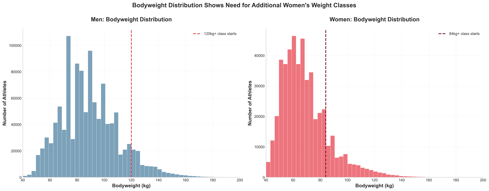
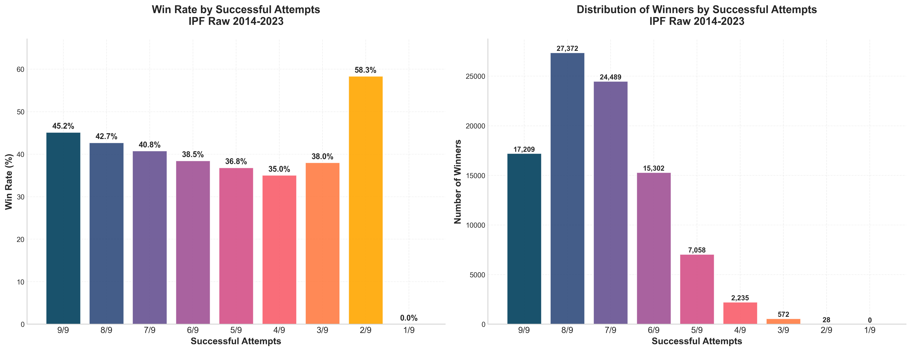

# OpenPowerlifting: Data Visualization

Exploratory analysis and visual storytelling on competitive powerlifting results from the
[OpenPowerlifting](https://www.openpowerlifting.org/) dataset: how the sport has grown, how weight
classes are populated, when athletes peak and whether making all nine attempts helps you win.

## Questions explored

1. **Gender composition over time**: how has the share of women in competitive powerlifting changed?
2. **Weight classes**: how do men's and women's bodyweight distributions compare with the IPF
   classes, and is there a case for more women's upper classes?
3. **Performance over time**: how have the best and median totals per weight class evolved
   in IPF Raw competitions (2010–2023)?
4. **Age and performance**: at what age do lifters peak?
5. **Regional growth**: which regions drive participation, with a focus on Italy?
6. **Attempts and winning**: are lifters who go 9-for-9 more likely to win, and which attempts
   are missed most often? (inspired by
   [Powerlifting in Data](https://powerliftingindata.com/posts/2024/11/03/lifters-going-9-for-9-are-more-likely-to-win.html))

## Highlights



The women's distribution has a long tail above the 84 kg+ threshold, so a single open class
groups very different athletes: the data supports adding upper weight classes for women.



In IPF Raw meets (2014–2023), win rate falls steadily from 45.2% for 9/9 lifters to 35.0% for 4/9.
The spikes at 3/9 and 2/9 rest on very few winners (572 and 28) and are not reliable.

More charts in [`viz/`](viz/): performance over time by weight class, weight class comparison,
age vs performance, regional growth and most-missed attempts.

## Data preparation

- Full-power (SBD) events only
- Rows without bodyweight or total removed
- Unrealistic values filtered (bodyweight 40–200 kg, total 100–1500 kg, age 10–100, single lifts 20–600 kg)
- IPF weight classes assigned by sex and bodyweight
- Time-based analyses restricted to Raw equipment and IPF-affiliated federations

## Usage

The dataset is not included. Download the CSV from the
[OpenPowerlifting data page](https://openpowerlifting.gitlab.io/opl-csv/bulk-csv.html) and save it as
`data/openpowerlifting.csv`, then:

```sh
pip install -r requirements.txt
jupyter notebook src/openPL_analysis.ipynb
```

**Stack:** Python, pandas, NumPy, Matplotlib, Seaborn.
